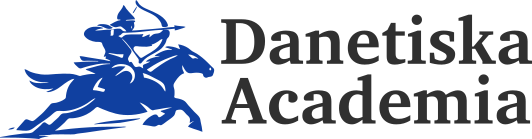

	

The **Danetian Academy** is a scholarly and cultural institution dedicated to
the cultivation of the
[Danetian language](/language), alongside its
literature, history, and culture.

As the language regulator for Danetian, the Academy establishes standards for
spelling, grammar, and usage, maintains the
[Dictionary of the Danetian Language](/dictionary),
and supports the development of terminology for literature,
scholarship, and everyday life.

The Danetian language and its institutions are the result of a long-term
constructed linguistic and cultural project. The Academy approaches this
material in a scholarly manner, treating it as an internally coherent system
subject to research, revision, and documentation.

## Contact

You may contact the Danetian Academy at the following email address:

**[academia@danetiska.com](mailto:academia@danetiska.com)**
